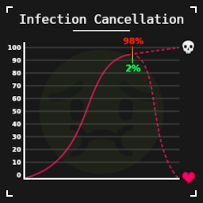

# Infection Cancellation

A Project Zomboid mod that gives you a small chance to survive a zombie infection.

## What it does

When your infection reaches ~95%, a dice roll determines whether your body fights it off. By default there's a **2% chance** to survive — configurable in Sandbox Options.

If you survive, the infection is cleared and you live to fight another day. If not, your fate is sealed.

## Sandbox Options

| Option | Default | Description |
|--------|---------|-------------|
| Survival Chance | 2% | Odds (0–100) of surviving an infection |
| Fast Healer bonus | Off | If enabled, the Fast Healer perk triggers the roll earlier (~45% instead of 95%) |

## Notes

- Requires Infection Mortality to be set to **3h–12h or longer** for the roll to trigger
- May be incompatible with other mods that alter infection behavior
- The mod can only cancel an infection, never cause one

